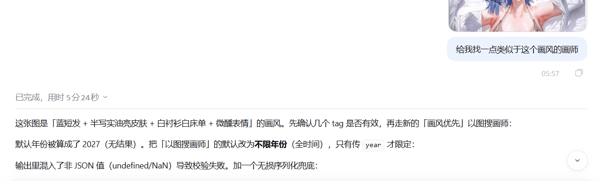

# DSH-D站搜索装置（dsh-danbooru-tools）

给 DeepSeek Harness 用的**只读 Danbooru 工具插件**：纯 Host 插件、零运行时依赖、不写任何文件，只用官方 JSON API。

> ⚠️ **这是 DSH 插件（bundle），不是可以直接双击/命令行运行的本地程序。** `index.js` 依赖 DSH 注入的 `ctx`（工具注册、凭据服务），直接 `node index.js` 会报错，也没有独立 CLI；必须按下面的「安装」章节装进 DeepSeek Harness 的 profile 才能用（名称里的 `dsh-` 前缀就是这个意思）。

> **AI 制作说明**：本项目由 **AI Agent**（DeepSeek Harness 中的会话 Agent）设计、实现与测试——代码、文档、检索算法与自检脚本均为 AI 生成，并经真实 API 请求验证；人类只负责提需求与验收结果。

它的目标是「AI 绘画提示词调研 + 画师调研」：把一个模糊想法变成可用的 Danbooru tag，再看真实作品如何用这些 tag；也可以按整年总收藏找画师（带体型 tag 闸门与年份范围链接），或用 HOT / 周榜 / 参考权重三级采样找参考画师。

## 宇宙免责声明（Cosmic Disclaimer）

> 本插件是「查询搬砖工」，不是内容提供者；它只负责把 Danbooru 的公开检索结果搬过来。

1. **版权归属**：所有作品与数据来自 Danbooru 公开 API，版权归各画师、权利人与 Danbooru 所有；本项目不存储、不转售、不再分发任何图片。
2. **使用范围**：仅供个人学习、研究与 AI 绘画提示词参考；请遵守 Danbooru 服务条款与当地法律。插件内置串行限速：**匿名 1.1 秒 / 登录后 0.4 秒**（仍远低于 D 站约 10 次/秒上限）——别拿它去 D 站刷屏，被限流了自己改 `minIntervalMs` 冷静一下。
3. **凭据安全**：API key 只存在你本机的 DSH 凭据库（owner-only），插件不收集、不上传、不打印、不写进缓存/仓库/发布包。
4. **结果不保证**：检索是 tag 频率/收藏数的启发式，可能不准、可能过时、可能「过于写实/有点 3D」——这属于正常波动，不是插件在针对你。
5. **侵权处理**：如果你是权利人或发现误标，欢迎提 issue 或联系作者；我们会在跑路之前先配合下架/修正（顺序很重要）。
6. **跑路条款**：若因使用本插件产生任何争议、索赔、限流、封号、世界末日或宇宙热寂，作者（AI Agent 及其人类甲方）将在 **0.5 秒内原地跑路**，不承担任何责任；届时本免责声明自动升级为「宇宙级」，并保留最终解释权（解释权也会一起跑路）。

—— 祝调参愉快，收藏永涨 📈

## 大致使用教程（截图版）

> ⚠️ **这只是「大致教程」**：截图来自插件开发调试时的真实会话，仅演示「怎么提问 / 工具输出长什么样」，不是严格步骤文档；具体参数、年份和结果以实际查询为准。

**① 以图搜画师：给它一张图，找画风相近的画师**



**② 按年份找「热门 + 色彩艳丽 + 人物油亮丰满」的作品**


**③ 找「画风贴近某画师」且限定上传年份（2025）**


## 安装（DSH profile）

本插件是 DSH bundle（纯 Host、零运行时依赖），以下三种方式任选其一。首次装完需重启 DSH；之后更新插件文件只需在 `plugin_manager` 里关→开热重载，不用重启。

### 方案 A：下载包（推荐，不需要 git）

1. 下载最新 zip：[Releases → v0.12.1 → `danbooru-tools-0.12.1.zip`](https://github.com/big-fat-fish-agent/danbooru-search-device/releases/latest)
2. 解压到任意目录，得到 `danbooru-tools/`
3. 安装：对 Agent 说「用 `plugin_manager` 的 `install_bundle` 安装 `<解压目录绝对路径>`」，或在 DSH 插件管理界面选择该目录
4. 重启 DSH

- 适合：不想装 git、只想能用
- 更新方式：重新下载 zip 覆盖目录 → 关→开热重载

### 方案 B：Git 克隆 + profile link（推荐长期使用 / 二次开发）

1. `git clone https://github.com/big-fat-fish-agent/danbooru-search-device.git`
2. 在 `$DSH_HOME/profiles/<profile>/package.json` 的 `dependencies` 里加：`"@local/dsh-danbooru-tools": "link:<克隆路径>"`
3. 把 `"@local/dsh-danbooru-tools"` 加进同一文件的 `dsh.bundles` 列表
4. 重启 DSH

- 适合：想跟踪更新、改代码、看 git 历史
- 更新方式：`git pull` → 关→开热重载（不用重装）

### 方案 C：GitHub 源码 zip（Release 不可用时的兜底）

仓库页 **Code → Download ZIP**，解压后按 **方案 A 的第 3–4 步**安装。内容与 Release 包相同，只是不带版本号标记。

### 卸载

`plugin_manager` 的 `remove_bundle`；或删除 profile `package.json` 里的依赖与 `dsh.bundles` 条目后重启 DSH。

装好后可选自检：`node verify.mjs`（约 3–5 分钟，真实请求，不写文件）。

## 工具

| 工具 | 作用 | 主要参数 |
|---|---|---|
| `danbooru_search_posts` | 按 tag 搜索作品，返回按分类拆好的 tag 集与图片 URL；可加 `year` 限定年份、`order=score` 按热度 / `order=rank` 按 Hot 排序 | `tags`、`limit`(1–100)、`page`、`rating`、`year`、`order` |
| `danbooru_top_artists` | **参考权重算法（HOT 优先）**：HOT 区权重 3 → 一周收藏增长权重 2 → 全年新图权重 1 | `year`(必填)、`tags`、`limit`、`sample`、`hot_sample`、`rising_sample`、`rating`、`weighting`、`rank_by`、`include_total` |
| `danbooru_year_artists` | **整年总收藏算法（独立于 HOT）**：按月采样整年、按该年作品**总收藏数**降序排画师；默认 5% 体型 tag 闸门（只认体型 tag，不认构图）；可选加肤色/肤质「人体参考」和「整体色调」参考 | `year`(必填)、`tags`、`rating`、`limit`、`monthly_sample`、`style_tags`、`style_preset`、`style_match`、`style_threshold`、`style_min_posts`、`style_min_hits`、`style_max_checks`、`appearance_tags`、`appearance_match`、`appearance_threshold`、`color_tags`、`color_match`、`color_threshold`、`compact` |
| `danbooru_search_tags` | tag 自动补全：规范名、分类、作品数 | `query`、`category`、`limit` |
| `danbooru_get_tag` | 单个 tag 详情 + wiki 摘要 + 别名/中日文名 | `name` |
| `danbooru_related_tags` | 共现相关 tag（含作品数、共现频率、余弦相似度） | `query`、`category`、`limit` |
| `danbooru_similar_artists` | **相似画师（tag 画像 + 表情画像）**：由种子画师的「特色 tag」与「表情 tag 画像」找候选，再按表情 tag 频率余弦重排 | `artist`(必填)、`limit`、`profile_tags`、`min_shared`、`examples`、`expression_tags`、`expression_weight` |
| `danbooru_artists_from_image` | **以图搜画师**：Agent 看图后给出 tag 分组，按分层优先级（人物→表情→绘制手法→线条→色彩→光照→tag；`mode="style"` 时手法/线条/色彩/光照优先）聚合画师 | `image_tags`(必填)、`person_tags`、`expression_tags`、`technique_tags`、`lineart_tags`、`color_tags`、`lighting_tags`、`mode`、`year`、`limit`、`examples`、`example_tags`、`allow_no_face` |
| `danbooru_style_match` | **整体画风匹配（角色锚定 → 同角色核验）**：先扫角色「全站最高分」作品（名次加权），再跑「角色×题材/画风」「画风×题材」pair 兜底，最后按「该画师同角色作品数」核验并附例图；输出六项目视核对清单与 `prefer_artists`/`avoid_artists` 迭代接口。`character` 支持逗号分隔多个角色（多张参考图场景） | `character`、`style_tags`、`genre_tags`、`year`、`rating`、`limit`、`per_query`、`examples`、`prefer_artists`、`avoid_artists`、`verify_same_character` |
| `danbooru_part_specialists` | **部位特化搜索**：按部位焦点 tag（`hand_focus`/`foot_focus`/`thigh_focus`…）检索该部位高收藏作品，按收藏聚合画师排名，并返回部位高收藏图片 | `part`(必填)、`year`、`rating`、`artists_limit`、`posts_limit`、`sample`、`min_posts`、`rank_by`、`include_posts` |
| `danbooru_get_post` | 单个作品：分类 tag 集 + 预览/大图/原图 URL | `id` |
| `danbooru_auth_status` | 看凭据是否已配置、来自哪里（不返回值） | 无 |
| `danbooru_save_credentials` | 把登录名与 API key 存进 Harness 凭据库（私有文件） | `login`、`apiKey`、`clear` |

典型用法：「初音未来的水手服怎么打 tag」→ `danbooru_search_tags("hatsune miku")` 拿到 `hatsune_miku` → `danbooru_get_tag("hatsune_miku")` 看 wiki 与别名 → `danbooru_related_tags("hatsune_miku")` 找常见服饰/构图 tag → `danbooru_search_posts(tags="hatsune_miku sailor_dress")` 看真实作品。

返回的图片 URL 可以直接交给 `read_image` 或 `web_fetch` 打开查看。

## 年份查询

D 站没有独立的「年份表」，年份过滤用的是 `date:` 元标签：`date:2025-01-01..2025-12-31`。注意三点：

- 单独写 `date:2025` 无效（返回 0 条），必须写完整日期范围；本插件的 `year` 参数会自动展开成范围并校验 2005–今年+1。
- D 站另有一个普通 tag `2025`（约 6,683 作品），含义是「以 2025 年为主题」的作品，**不代表**「2025 年发布」，不要拿它做年份筛选。
- `date:`、`rating:`、`order:` 都是元标签，**不占**真实 tag 额度；匿名/会员的 2/3 个 tag 限制只算真实 tag。

用法：

- 查某年某画师/角色的作品：`danbooru_search_posts(tags="gogogo_(gogogorx)", year=2025, order="score")`（配 `rating=all` 可放开分级）
- 查某年热门画师：`danbooru_top_artists(year=2025)` → 默认采样该年最高分的 200 张，按「总分 → 上榜作品数」排序；`tags` 可再限定角色/版权/主题，`sample` 调样本量（默认 200 = 1 次请求，上限 600 = 3 次请求），`rank_by` 切换口径（`total_score` 默认 / `avg_score` / `posts` 按高产），`include_total` 额外返回该年作品总数（多 1 次请求）
- 返回里每个画师都带 `posts`（样内作品数）、`total_score`、`avg_score`、`top_score` 和 `example`（最高分作品 id/链接/预览图）

## 参考权重（三级采样，默认开启）

`danbooru_top_artists` 默认按参考优先级给画师加权，模拟人工挑参考的顺序：

| 层级 | 数据源 | 权重 | 说明 |
|---|---|---|---|
| Hot | `posts.json?tags=order:rank`（D 站「Hot」页） | 3 | 只覆盖**近期上传**；过去年份查询会自动跳过，并在 `tiers.hot.skipped` 里说明 |
| 一周收藏增长 | `/explore/posts/popular.json?scale=week&date=<锚点>`（Popular 页周榜，按该周新增收藏排序） | 2 | 锚点：当年 = 今天；过去年份 = 该年 12-31 所在周。该接口不支持服务端 tag/rating 过滤，插件在客户端过滤 |
| 全年新图 | `posts.json`：最新一页 + 最高分一页（含 `date:` 年份与用户 tag） | 1 | 兜底采样：默认 2 次请求（200 张新图 + 200 张高分图），既覆盖全年又不丢新图 |
| 兜底（uniform 模式） | `posts.json` + `order:score` | 1 | 仅 `weighting="uniform"`：按分数采样全年图，无三级权重 |

- **排序默认 `reference_priority`**：HOT 命中数 → 周榜命中数 → 兜底样本数 → 总分（完全按你说的优先级）；`rank_by` 可切 `weighted_score`（Σ 权重×得分）/ `total_score` / `avg_score` / `posts`
- **同一画师尽量取新图**：`example` 是该画师采样到的最新作品，`top` 是最高分作品
- 每个画师返回 `artist_url`（D 站画师页；带年份时自动附 `date:YYYY-01-01..YYYY-12-31` 时间范围）、`tier_posts`（各层级命中数）、`weighted_posts`、`weighted_score`
- 成本：默认 4 次请求（Hot 1 + 周榜 1 + 兜底 2）；`hot_sample` / `rising_sample` 调样本量
- 注意：周榜以 R18 为主；默认 `rating=all` 时周榜正常生效，若把 `rating` 收窄到 `g` 会被过滤空（`tiers.rising.sampled = 0`）

## 整年总收藏算法（独立于 HOT）

`danbooru_year_artists` 是另一套算法，**不使用 HOT/周榜权重**，专门回答「某一年里哪些画师最受欢迎」：

- 数据源：`posts.json` 按月分批（`date:YYYY-MM-01..月末` + `order:favcount`），取每月收藏数最高的一批作品（默认 200 张 = 每月 1 次请求）
- 聚合：把样本内每张图的 `fav_count` 累加到画师身上，按**该年总收藏数**降序排名；同时给出 `artist_url`（画师页，自动带该年份 `date:` 范围）、`posts`（样本内作品数）、`avg_favorites`、`months`（覆盖月份数）、`best`（最高收藏作品）、`newest`（最新作品）
- 覆盖范围：过去年份 = 12 个月；当年 = 1 月到当前月；整年都算上，不做「最近才上传」的偏向
- 代价与偏差：总收藏是**样本估算**——每月只取收藏榜前 `monthly_sample` 张，榜外作品不计；因此会漏掉「刚上传还没积累收藏」的优秀图（这正是你要的取舍）
- 成本：每覆盖一个月 1 次请求（2025 年 = 12 次；2026 年 11 月 = 11 次）
- 默认 `rating=all`（**含 R18**，收藏/热榜的真实分布如此）；需要安全内容时显式传 `rating="g"`

## 风格占比测量（按 tag 比例标注，默认 5% 闸门）

想找「肉感画师」时，用 `style_tags` 或 `style_preset` 让工具核验并标注每位画师的风格 tag 占比：

- `style_preset="fleshy"` = `thick_thighs` + `plump` + `curvy` + `wide_hips` + `pear-shaped_figure`（**只用体型 tag**）
- 也可以传 `style_tags="thick_thighs,plump"`；`style_match="any"`（默认，命中任一即算）或 `"all"`（必须全中）
- **只认体型 tag，不认姿态/构图 tag**：`ass_focus` / `from_behind` / `bent_over` / `spread_legs` 这类构图不会算作肉感证据，只作为 `style.pose_posts` 诊断项返回——避免「构图肉」冒充「体型肉」
- **判定方式**：按总收藏从高到低核验候选画师——拉该画师**同一年**最多 100 张高收藏作品（1 次请求/人），算「带体型 tag 的图 / 核验图数」
- `style_threshold`：**默认 0.05（5%）**；传 0 则只测量不淘汰
- `style_min_hits`（默认 2）：至少要有 2 张带 tag 的图才可能通过，避免「1 张图刚好 2%」的噪声
- `style_min_posts`（默认 3）：该年作品少于这个数不做判定
- `style_max_checks`（默认 40）：最多核验多少位候选，够 `limit` 位就提前停
- `compact=true`：只返回名字/总收藏/作品数/风格占比，不返回作品引用，适合批量看比例
- 加了年份就只核验**该年份**的作品（`year` 本来就是必填）
- 返回里每位画师带 `style: { tags, match, threshold, min_hits, checked_posts, hit_posts, ratio, pose_posts, best }`；`best` = 该画师**带风格 tag 的**最高收藏作品（最多 3 张），可直接点开参考（"优先看带 tag 的图"）；顶层 `style_filter` 说明核验几人、通过几人

## 人体附加参考（肤色 / 皮肤质感）

体型之外，`danbooru_year_artists` 还支持在**同一批核验作品**上统计「人体参考」tag，不额外发请求：

- `appearance_tags`：逗号/空格分隔，例如 `pale_skin, shiny_skin`
  - 肤色：`pale_skin`、`dark_skin`、`tan`、`tanlines`、`grey_skin`、`blue_skin`…
  - 皮肤质感：`shiny_skin`、`sweat`、`wet`、`oiled_skin`、`lotion`、`dimples_of_venus`…
  - **不含眼睛颜色**：眼睛属于角色特征，整体视觉参考请用下面的 `color_tags`
- `appearance_match`：`any`（默认，命中任一即算）或 `all`（必须全中）
- `appearance_threshold`：默认 0 = **只统计不淘汰**；传 0.1~0.3 这类比例才按「带参考 tag 的占比」加一道闸门
- 返回里每位画师带 `appearance: { tags, match, threshold, checked_posts, hit_posts, ratio, per_tag, best }`
  - `per_tag`：每个参考 tag 在核验作品里的命中数（比如 `shiny_skin: 6`）
  - `best`：带参考 tag 的最高收藏作品（最多 3 张），可直接点开看肤色/肤质是否真的贴合
- 顶层 `appearance_filter` 与 `style_filter` 并列，说明核验人数、通过人数
- 典型用法：`style_preset="fleshy"` + `appearance_tags="pale_skin,shiny_skin"`，一次查询按「体型 + 肤色 + 肤质」给画师打分

## 整体色调参考（画面观感）

「整体参考」不再挂在人体上，而是单独统计**整张画面的色调**——同样复用那批核验作品，不额外发请求：

- `color_tags`：逗号/空格分隔，例如 `monochrome, blue_theme`
  - 单色/低饱和：`monochrome`、`monochrome_background`、`partially_colored`、`limited_palette`
  - 主题色：`blue_theme`、`red_theme`、`green_theme`、`purple_theme`、`pink_theme`、`yellow_theme`
  - 色彩风格：`colorful`、`colorful_background`、`pastel_colors`、`iridescent`、`gradient_background`
- `color_match`：`any`（默认）或 `all`
- `color_threshold`：默认 0 = 只统计不淘汰；传比例则加闸门
- 返回里每位画师带 `color: { tags, match, threshold, checked_posts, hit_posts, ratio, per_tag, best }`
  - `per_tag`：每个色调 tag 的命中数（比如 `blue_theme: 9`）
  - `best`：带色调 tag 的最高收藏作品（最多 3 张），点开就能看整体色调是否对味
- 顶层 `color_filter` 说明核验人数、通过人数
- 典型用法：`color_tags="monochrome,limited_palette"` + `color_threshold=0.2`，筛出「整体偏单色/限定色」的画师
- 成本：和 `appearance_tags` 共用核验请求，不额外增加请求数

## 相似画师（tag 画像 + 表情画像）

`danbooru_similar_artists` 用 Danbooru 的 tag 共现数据找「风格相近」的画师（**不是图像 embedding**）：

1. 取种子画师的 `related_tag`，筛出「对 TA 高频、但全站不算通用」的 general tag（排除 `1girl`、`highres`、背景色等结构性 tag），作为风格画像（`profile_tags`，默认取 6 个）
2. **表情画像**：从种子画师的 tag 画像里挑出表情 tag（`smile`、`blush`、`open_mouth`、`half-closed_eyes`、`tongue_out` 等，`expression_tags` 默认 4 个），用它们把「表情习惯相近」的画师也拉进候选池
3. 对每个画像 tag 查 `related_tag&category=artist`，收集共享该 tag 的画师，按 `频率 × tag 稀有度` 加权累加
4. 候选 = 风格画像候选 ∪ 表情画像候选；表情候选必须通过「风格 tag 重叠检查」（同一批 `related_tag` 里能查到种子风格 tag），避免只表情像、画风完全不像
5. 最终分数：`(1 - expression_weight) × 风格分 + expression_weight × 表情余弦分`；表情余弦对表情 tag 频率做**稀有度加权**（`expression_weight` 默认 0.5）

- 成本：1 次（种子画像）+ `profile_tags` 次 + `expression_tags` 次 + 最多 `2 × limit` 次（表情余弦/风格重叠检查），默认约 1 + 6 + 4 + 20 = 31 次请求
- **例图软规则**：`examples>0` 时默认优先「带需求 tag（表情/体型）+ 能看到脸」的作品；只有用户明确要求背影、剪影、下半身特写等无脸构图时才传 `allow_no_face=true`；`example_tags` 可覆盖需求 tag，每条例图带 `matched_tags` 便于核对；没有可用样图的帖子会被跳过
- **题材降权**：相似度计算里 `furry` / `furry_female` / `furry_male` / `anthro` / `humanoid_furry` 的权重乘 **0.05**，避免兽向题材拉动画师相似度
- 局限：tag 层面的表情相似（用哪些表情、多常用）仍不等于「表情画法」相似（眼型、嘴形、腮红画法）；必须 `read_image` 目视后才能下结论
- 用法：`danbooru_similar_artists(artist="satou_kuuki", limit=10, examples=3)`

## 以图搜画师（图 → 画师）

`danbooru_artists_from_image` 把「以图搜画师」固化为**分层优先级检索**（插件没有视觉能力，由 Agent 看图后提供 tag 分组）：

| 维度 | 说明 | `mode="person"` 权重 | `mode="style"` 权重 |
|---|---|---|---|
| `person` 人物风格 | 体型比例、面部特征、角色设计 | 0.22 | 0.08 |
| `expression` 表情 | 表情 tag | 0.12 | 0.02 |
| `technique` 绘制手法 | 材质/上色（`latex`、`shiny_clothes`…） | **0.22** | **0.28** |
| `lineart` 线条 | 线稿粗细/有无/彩色线（`lineart`、`colored_lineart`…） | **0.18** | **0.24** |
| `clothing` 服装质感 | 材质 tag：`latex`、`leather`、`shiny_clothes`、`wet_clothes`、`see-through_clothes`、`lace`… | **0.10** | **0.12** |
| `color` 色彩 | 主色/饱和度/多彩/虹彩（`colorful`、`iridescent`…） | 0.06 | 0.12 |
| `lighting` 光照 | 逆光/斑驳光/镜头光（`dappled_sunlight`、`backlighting`…） | 0.05 | 0.10 |
| `tag` 泛 tag | 其余描述 tag | 0.05 | 0.04 |

> 线条/绘制手法权重高于旧默认（person 模式 lineart 0.18、technique 0.22；style 模式 0.24 / 0.28），并新增 `clothing` **服装质感** 维度（0.10 / 0.12），专门吃 `latex`、`leather`、`shiny_clothes`、`see-through_clothes` 这类服装材质 tag——和 `technique`（皮肤/整体上色材质）分开计分。

- **角色身份/装饰特征不计分**：发色、瞳色、角、光环、兽耳、尾巴、饰品、服装名词（`lingerie`、`bra`、`shirt`…）会在评分前被剔除，并在返回的 `excluded_identity_tags` 里列出；材质 tag（`latex`、`lace`、`see-through_clothes`）保留。以图搜画师只该描述「怎么画的」，而不是「画的是谁」。
- **强调「画风类似」**：用 `mode="style"` → 绘制手法 → 线条 → 服装质感 ≈ 色彩 → 光照 → 人物 → 表情 → tag
- **强调「人物方面」或未说明**：`mode="person"`（默认）→ 人物 ≈ 绘制手法 → 线条 → 表情 → 服装质感 → 色彩 → 光照 → tag
- 每个维度**最多取 4 个 tag，逐个 tag 单独检索**（各 100 条，`order:score`）；同一维度内按帖子去重，再按画师出现频率加权累加
- `year` 可选：**不填默认全时间**（不限年份），填了才按该年过滤
- 成本：约 5–20 次请求（各组 tag 数之和，最多 4×7）+ `examples` 次
- 用法：
  `danbooru_artists_from_image(image_tags="white_shirt, lying, white_background", person_tags="blue_hair, yellow_eyes", expression_tags="half-closed_eyes, blush", technique_tags="shiny_skin, realistic", lineart_tags="lineart, colored_lineart", clothing_tags="latex, shiny_clothes", color_tags="colorful, blue_theme", lighting_tags="dappled_sunlight, backlighting", mode="style", limit=10, examples=3)`
- 局限：仍是 tag 检索聚合，不是图像 embedding；最终必须 `read_image` 目视确认

### 借鉴与放弃（对照 Google 以图搜图）

- **借鉴并已实现：近重复/同源图聚类**——同一张画的改色、裁切、variant 帖在 Danbooru 上共享 `parent_id` 或 `md5`，`artists_from_image` 先按「视觉簇」去重再计分，避免同一张画给同一画师叠加多次证据；例图也只从不同簇里挑。`part_specialists` 同样折叠重复图（顶层返回 `deduped_posts`）
- **借鉴并已有：多信号排序 + 兜底**——分层维度加权、收藏热度排序；例图优先「带需求 tag + 有脸」，找不到才逐级放宽
- **放弃：视觉 embedding 检索**——需要本地 CLIP/BLIP 级模型（几 GB 依赖），和「零运行时依赖、轻量、只读 API」的定位冲突；Danbooru 也没有公开的相似图/向量检索 API
- **放弃：OCR 识别签名/水印**——需要 OCR 依赖；而会话里 Agent 本身就能看图上的文字，没必要塞进插件
- 若以后真要做视觉向量检索，应**单开一个子插件**（本地视觉服务负责图 → embedding，再向本插件提供候选），而不是把重依赖塞进这个插件

## 整体画风匹配（角色锚定 → 同角色核验）

`danbooru_style_match` 是「同一作者/同一套图反推画师串」这类任务沉淀下来的检索方案：**不问「谁画了这些特征」，而问「谁画过同一个角色、同一类场景、并且整体画法一致」**。

**为什么不能按特征 tag 找**：`half-closed_eyes`、`eyeshadow`、`dark-skinned_male`、`sparkle`、`shiny_skin` 这类 tag 在 AI 图里多半是 prompt 效果，同题材画师几乎人人都有；按它们聚合只会得到「同题材画师榜」，而不是「同画风画师榜」。画师真正决定的是：**线稿、上色、色调、人体比例、脸部构造、构图**。

**工具内部的检索顺序**：

1. **全站高分锚点（核心）**：用 `character`（无角色时用第一个 `style_tag`）单独查 `order:score` 的前 200 张，按名次衰减加权——名次越靠前权重越高。单 tag + `order:score` 只占两个 tag 额度，**匿名也能用**，且能覆盖几年前的高分老图。
2. **pair 查询兜底**：`角色×题材`、`角色×画风`、`画风×题材` 各最多 2 组（每组正好两个真实 tag，适配匿名 2-tag 限制）；pair 只能取最新页，客户端再按分数排序，用来补近期/新画师。
3. **同角色核验**：对候选逐个查 `画师×角色`，统计该画师自己的同角色作品数——「已经画过这个角色」是最强的 tag 侧证据；这段查询返回的作品同时就是最好的例图。
4. **加权排序**：`0.55×锚点分 + 0.25×pair 分 + 0.2×同角色分`（无角色时只按锚点/pair）；若候选在「全站前 10 名」里出现过，再 ×1.3（`chart_top=true`），因为作品能排到该角色收藏榜最前本身就是强证据。`prefer_artists` 会额外加分，`avoid_artists` 直接剔除。
5. 返回 `verify.checklist`（线稿 / 上色 / 色调 / 人体 / 脸 / 构图 六项目视核对清单）与 `iterate.hint`，方便下一轮接着迭代。

**三条关键经验（已写进实现）**：

- 同角色作品「多」≠ 画风像，但「有」是必要条件；所以同角色只做证据加分，主排序仍是「全站高分作品里的出现」。
- 只按最新页搜 `角色×题材` 会漏掉几年前的高分老图（例：某画师的同角色作品在收藏前列，但发布于两年前）——所以必须有 `order:score` 锚点扫描。
- 例图必须**整体**比对：线稿→上色→色调→人体→脸→构图逐项过，不能因为「半闭眼/红眼影」对上了就定案。

用法：

- 带角色：`danbooru_style_match(character="firefly_(honkai:_star_rail)", style_tags="shiny_skin, colored_lineart", genre_tags="sex, sweat", limit=10, examples=2)`
- 无角色：`danbooru_style_match(style_tags="shiny_skin, sweat, colored_lineart", genre_tags="sex", limit=12, examples=2)`
- 迭代：上一轮看中的画师放进 `prefer_artists`、看错的放进 `avoid_artists`，再跑一次即可收敛
- 成本：约 `1 + 6 + 2×limit + 少量例图` 次请求（默认约 30 次；匿名限速下约 30–40 秒）

### 多张参考图 / 多角色（0.18.0 起）

同一作者的一套图常常横跨好几个角色；只锚定一个角色会漏掉「画过其他角色、但整体画法相同」的画师。`character` 现在接受**逗号分隔的多个角色**（最多 3 个，前两个会各跑一次全站高分锚点并参与同角色核验）：

- 多角色输入：`danbooru_style_match(character="firefly_(honkai:_star_rail), kafka_(honkai:_star_rail)", style_tags="shiny_skin, sweat", genre_tags="sex, hetero", limit=10, examples=2)`
- 输出：`reference.characters` 是解析后的角色列表；`anchor_scans` 每个角色一条；每个候选多带 `same_character_breakdown`（逐角色作品数），`same_character_posts` 是各角色之和。
- 推荐流程（本轮实测收敛最快）：① 参考图按角色/服装分组，每组挑最接近的 `style_tags` 各跑一次；② 汇总多轮候选，**同名画师跨轮出现**的优先；③ 对 finalist 抓 2–3 张代表作和参考图拼图，按六项清单整体比对；④ 用 `prefer_artists` 把入选者带回再跑一轮；⑤ 最后才写画师串权重。
- 成本：每多一个角色约多 `1 + 2 + 2×limit` 次请求（前两个角色参与核验）。

**本轮案例（15 张同一 AI 作者参考图）**：Firefly 9 张、蓝发泳装 3 张，棕发蓝挑染 / 深紫发 / 红发军装 / 粉发和服各 1 张。多轮检索（Firefly 锚点 → 泳装/latex/和服锚点 → prefer 迭代 → 13 名候选逐一看图）后收敛到：`hews`（脸/线条/构图主源）、`0haribo0`（背身/油亮/细线）、`harin_05`（苍白油亮肉体/POV）、`greem_bang`（重油光 + 深色乳晕）四个候选，`mochirong` / `mignon` 只作白底与冷调补充——比 0.16.x 只按特征 tag 得出的 `mochirong` 结论整体贴近得多。

## 部位特化搜索（画手 / 画脚 / 画腿…）

`danbooru_part_specialists` 用 D 站的**部位焦点 tag** 检索「该部位 + 高收藏」作品，再按画师聚合，专门回答「谁画手/脚/腿/眼睛画得好」这类问题。

- `part` 可选：`hands`、`feet`、`thighs`、`legs`、`ass`、`breasts`、`hips`、`eyes`、`mouth`、`back`、`armpits`、`navel`、`belly`、`abs`、`hair`、`neck`、`pectorals`
- 每个部位取前两个 tag（如 `hand_focus` + `hands`），按 `order:favcount` 各扫一遍（默认 100 条），统计画师在该部位作品上的**收藏总数**
- `rank_by`：`total_favorites`（默认，收藏总量）/ `avg_favorites`（单图均值）/ `posts`（作品数量）
- `min_posts`：画师至少要有几张部位作品才入榜（默认 2）
- 同时返回 `posts`：该部位 tag 下收藏最高的图片（默认 6 张，含 `sample_url`）
- 只选图片，视频自动过滤；`year` 可限定年份（默认全时间）
- 用法：`danbooru_part_specialists(part="hands", year=2025, rank_by="total_favorites", artists_limit=10, posts_limit=8)`
- 局限：依赖作者打了部位焦点 tag，没打 tag 的好图会漏；最终仍需目视确认部位画法

## 输出约定（画师 vs 图片）

- **画师列表**：每位画师保留 **3 张例图**（不同作品），并**分行纵向排版**（每人一个块：渲染 / 体态 / 面部 / 主页 / 例图），不要用宽表格，避免被横向裁切
- **例图软规则**：默认优先取「带需求 tag（表情/体型）+ 能看到脸」的作品；只有用户明确要求背影、剪影、下半身特写等无脸构图时，才传 `allow_no_face=true` 允许无脸例图；`example_tags` 可覆盖需求 tag。`danbooru_similar_artists` 的 `examples` 会返回 `matched_tags` 便于核对
- **气质降权**：相似度计算里 `furry` / `furry_female` / `furry_male` / `anthro` / `humanoid_furry` 的权重乘 **0.05**，避免兽向题材拉动画师相似度
- **避免过度写实/3D**：`3d`、`photorealistic`、`faux_3d` 这类 tag 在相似度中降权到 0.05；以图搜画师会按候选的 3D 作品占比扣分（返回 `three_d_share`）；例图和部位特化结果优先排除 3D 作品（找不到 2D 图时才回退）
- **图片列表**：每张图保留 **1 张样图**即可
- **画风相似判定维度**（目视，不只看 tag）：
  1. **渲染**：上色/软硬阴影、高光与材质（乳胶、亮面布料）、饱和度与色调
  2. **体态**：胸腰臀/腿比例、肉感与脂肪分布、身高体型、常用姿态
  3. **面部特征与表情**：脸型、眼型/眼距/瞳孔高光、鼻嘴画法、腮红、常用表情（笑/半闭眼/吐舌/害羞等）
  4. **构图**：立绘/多视图/近景裁切等

## 凭据（登录后解除 2-tag 限制）

调用 `danbooru_save_credentials` 提供 `login` 与 `apiKey`：值写入 DSH 凭据库（`$DSH_HOME/.credentials.yaml`，仅当前系统用户可读），不会出现在插件配置或工具返回值里。插件每次请求都会重新解析凭据，保存后立即生效、无需重启。

- 查看状态：`danbooru_auth_status`（只报 configured / source / writable，不返回值）
- 移除：`danbooru_save_credentials({ clear: true })`
- 也可以用环境变量 `DANBOORU_LOGIN` / `DANBOORU_API_KEY`（启动环境或 `$DSH_HOME/.env`）；凭据库中的值优先。

## 合规与限速（内建）

- 每个请求都带可识别 `User-Agent`：`dsh-danbooru-tools/0.18.1 (DeepSeek Harness; <contact>)`。
- 所有请求走**单一串行闸门**：匿名默认间隔 1.1 秒；检测到已保存凭据时自动切成 0.4 秒（约 2.5 次/秒，仍只有 D 站 10 次/秒上限的 1/4，多请求工具整体快约 2–2.7 倍）；遇到 429 会按 `Retry-After` 退避重试一次。
- 结果有内存 TTL 缓存（作品 5 分钟 / 自动补全 6 小时 / 相关 tag 1 小时 / wiki 24 小时），减少重复请求。
- **对 Danbooru 只读**：只发 GET 请求，不点赞、不收藏、不上传、不写 profile；不产生任何对站点的写入。

## 配置

全部可选。可用环境变量或 bundle patch 的 `config` 提供：

| 键 | 默认 | 说明 |
|---|---|---|
| `contact` | 空 | 加进 User-Agent 的身份说明，建议填 `user #12345` 或邮箱 |
| `minIntervalMs` | `1100` | 匿名请求的启动间隔（毫秒） |
| `minIntervalMsAuthenticated` | `400` | 已保存凭据时的启动间隔（毫秒），必须小于站点限速 |
| `timeoutMs` | `20000` | 单请求超时 |
| `cacheTtlMs` | `600000` | 内存缓存寿命；`0` 关闭缓存 |
| `defaultRating` | `all` | 默认分级；`all` 含 R18，`g` 只看全年龄 |
| `maxWikiChars` | `4000` | `danbooru_get_tag` 返回的 wiki 摘要上限 |

环境变量：

| 变量 | 说明 |
|---|---|
| `DANBOORU_LOGIN` | Danbooru 用户名；与 API key 同时提供时提高限额（匿名最多 2 个 tag） |
| `DANBOORU_API_KEY` | 个人页的 API key |
| `DANBOORU_USER_AGENT` | 完整覆盖 User-Agent（仍要保留可识别身份） |
| `DANBOORU_CONTACT` | 等同 `contact` 配置项 |
| `DANBOORU_MIN_INTERVAL_MS` | 等同 `minIntervalMs` |
| `DANBOORU_MIN_INTERVAL_AUTH_MS` | 等同 `minIntervalMsAuthenticated` |

改 `config` 需要改本目录的 `cordis.patch.yml` 并重装 bundle；改环境变量则重启 DSH 即可。

## 自检

```bash
node verify.mjs
```

会真实请求各查询工具（工具注册、凭据降级、年份过滤、三级加权、整年总收藏、风格闸门、人体附加参考、整体色调参考、表情画像与余弦、例图软规则、部位特化、线条/手法/服装质感权重、角色身份过滤、整体画风匹配的锚点/同角色/清单等 56 项检查）并校验返回结构与排序，约 2–3 分钟（受串行限速影响）。不产生写入。

## 已知限制

- 匿名搜索最多 2 个 tag（Danbooru 服务端限制）；错误信息会提示加凭据。
- 只读 ≠ 不能看图：插件只读 Danbooru、不提供图片下载工具，但**返回作品/样本 URL**（`urls.sample`、`preview_url` 等）。目视核验时由 Agent 用 `curl` / `pwsh` 从这些 URL 临时下载到本地、看完即删；插件自身不发起图片下载。

### 图片核验（Agent 侧工作流）

1. 用 `danbooru_search_posts`（`urls.sample`）或 `danbooru_year_artists`（`best` / `newest` / `style.best` 里的 `sample_url`）拿到可下载的样图 URL；
2. 用 `curl` 下载（CDN 有防盗链，**必须带 Referer**，否则 403）：
   `curl.exe -L -e "https://danbooru.donmai.us/" -o sample.jpg "<sample_url>"`
3. 用 `read_image` 查看；核验完删除临时文件（不进入插件目录、不长期保存）。

- 插件没有「批量下载图片」的工具；下载发生在 Agent 的 shell 侧，属于会话临时操作，不是插件能力。
- 内容分级**默认返回全部（含 R18）**；需要全年龄内容时显式传 `rating="g"`，结果可能不适合所有场景。
- **只返回图片**：所有工具都会过滤掉视频与动画作品（`mp4`/`webm`/`mkv`/`mov`/`avi`/`m4v`、ugoira 的 `zip`，以及 `meta` 里带 `ugoira`/`video` 的帖子），搜索、画师参考图、例图都只给静态图；`danbooru_get_post` 按 id 查询除外（显式请求仍可看到原帖信息）
- wiki 摘要是截断后的纯文本，保留了 Danbooru 的 wiki 标记（如 `[[tag]]`），不是渲染后的富文本。

## 更新记录

- **0.18.1**：`artists_from_image` 不再把**角色身份/装饰特征**当成画风证据——发色、瞳色、角、光环、兽耳、尾巴、饰品、服装名词（`lingerie`、`bra`、`shirt`…）在评分前剔除并返回 `excluded_identity_tags`；材质 tag（`latex`、`lace`、`see-through_clothes`）保留。全部 tag 都是身份特征时明确报错，提示改传绘制手法类 tag
- **0.18.0**：`danbooru_style_match` 支持**多角色**——`character` 可传逗号分隔的多个角色（最多 3 个，前两个各跑全站高分锚点并参与同角色核验）；新增 `reference.characters` 与 `same_character_breakdown`（逐角色作品数，总数仍为 `same_character_posts`）；`verify.mjs` 增加多角色自检；README 增加「多张参考图 / 多角色」工作流与 15 图案例
- **0.17.0**：新增 `danbooru_style_match`（整体画风匹配）：角色锚定 + 全站高分 `order:score` 扫描（名次衰减加权）+ `角色×题材/画风`、`画风×题材` pair 兜底 + `画师×角色` 同角色核验 + 例图；输出六项目视核对清单与 `prefer_artists`/`avoid_artists` 迭代参数，返回新增 `anchor_scans`、`anchor_score`/`pair_score`/`chart_top` 字段（全站前 10 名作品额外 ×1.3）；`verify.mjs` 增加 5 项自检
- **0.16.1**：README 在「宇宙免责声明」与「安装」之间新增「大致使用教程（截图版）」三张示例图（以图搜画师 / 按年份找色彩艳丽作品 / 相似画师+年份限定），图片存于 `docs/tutorial/`
- **0.16.0**：`artists_from_image` 新增 **服装质感** 维度 `clothing_tags`（person 0.10 / style 0.12，专吃 `latex`、`leather`、`shiny_clothes`、`see-through_clothes` 等材质 tag）；线条/手法权重微调（person 0.18/0.22、style 0.24/0.28），其余维度等比下调，总和仍为 1
- **0.15.2**：加强线条与绘制手法的参考权重——`artists_from_image` person 模式 lineart 0.12→**0.20**、technique 0.20→**0.24**；style 模式 lineart 0.18→**0.26**、technique 0.26→**0.30**（其余维度等比下调，总和仍为 1）
- **0.15.1**：性能优化——登录后自动使用 0.4 秒限速间隔（匿名仍 1.1 秒），多请求工具整体快约 2–2.7 倍（实测 12 请求的 `year_artists` 12.8s → 6.4s）；新增 `minIntervalMsAuthenticated` / `DANBOORU_MIN_INTERVAL_AUTH_MS`；其他行为、输出与排序不变
- **0.15.0**：借鉴以图搜图的「近重复聚类」——以 `parent_id`/`md5` 把同一张画的不同变体（改色、裁切、variant 帖）归为一个视觉簇；`artists_from_image` 按簇去重后再聚合证据，例图只取不同簇；`part_specialists` 也按簇折叠重复图；输出增加 `dedupe` 与每组 `unique_clusters` / `deduped_posts`
- **0.14.0**：眼睛色彩从「人体附加参考」中移除；新增「整体色调参考」`color_tags` / `color_match` / `color_threshold`（`monochrome`、`limited_palette`、`pastel_colors`、`blue_theme`、`colorful`、`iridescent` 等），返回 `color.per_tag` 与 `color.best` 参考图
- **0.13.0**：`danbooru_year_artists` 新增「人体附加参考」`appearance_tags` / `appearance_match` / `appearance_threshold`：在同一批核验作品上统计肤色、皮肤质感 tag（`per_tag` 命中数 + `ratio` + `appearance.best` 参考图），可只统计或按比例加闸门
- **0.12.2**：插件标题/介绍统一加 `DSH-` 前缀，并明确标注「DSH bundle，不是可独立运行的程序」
- **0.12.1**：仓库转为公开；README 与插件介绍标注「AI 制作」；安装章节拆分为「下载包 / git clone + link / 源码 zip」三种方案；新增「宇宙免责声明」（跑路条款）
- **0.12.0**：过滤/降权 3D 渲染（`3d`/`photorealistic`/`faux_3d`）：相似度降权 0.05、以图搜画师按 `three_d_share` 扣分、例图与部位图优先排除 3D
- **0.11.0**：以图搜画师新增 `lineart_tags`（线条）与 `lighting_tags`（光照）维度，且每个维度最多 4 个 tag 全部参与检索（之前只查前两个），线条/色彩/光照正式进入评分
- **0.10.1**：以图搜画师默认不限年份（`year` 不填=全时间），修复输出里的非 JSON 值导致 `not lossless JSON` 的问题
- **0.10.0**：新增 `danbooru_part_specialists`（部位特化：按部位焦点 tag 的高收藏作品聚合画师排名 + 部位高收藏图片）
- **0.9.1**：全工具只返回图片（过滤 `mp4`/`webm` 等视频；搜索、画师参考图、例图均跳过视频）
- **0.9.0**：新增 `danbooru_artists_from_image`（以图搜画师，分层优先级：人物→表情→绘制手法→色彩→tag；`mode="style"` 时手法/色彩优先）
- **0.8.3**：清理过时文档（重复的安装章节、旧的自检耗时、工具数量），DSH 内与仓库说明同步为当前能力（表情画像/余弦、例图软规则、furry 降权）
- **0.8.2**：例图改为软规则（默认优先带脸，`allow_no_face=true` 放行无脸构图）；`furry` 类 tag 相似度权重 ×0.05；过滤无 `sample_url` 的例图
- **0.8.1**：例图强制匹配需求 tag 并跳过隐藏脸的构图（已由 0.8.2 改为软规则）
- **0.8.0**：相似画师新增表情画像、表情 tag 扩展、稀有度加权表情余弦与风格重叠检查
- **0.7.2**：例图按需附带样图 URL（`examples`）
- **0.7.0**：新增 `danbooru_similar_artists`（tag 画像相似画师）
